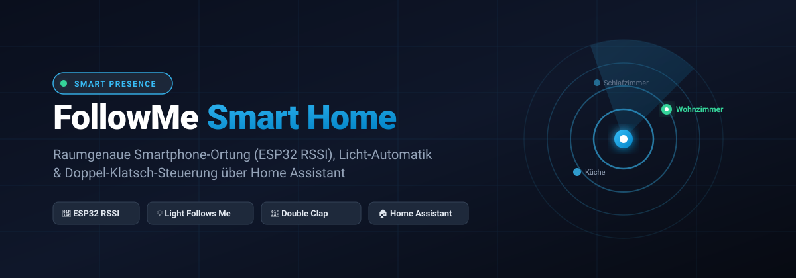
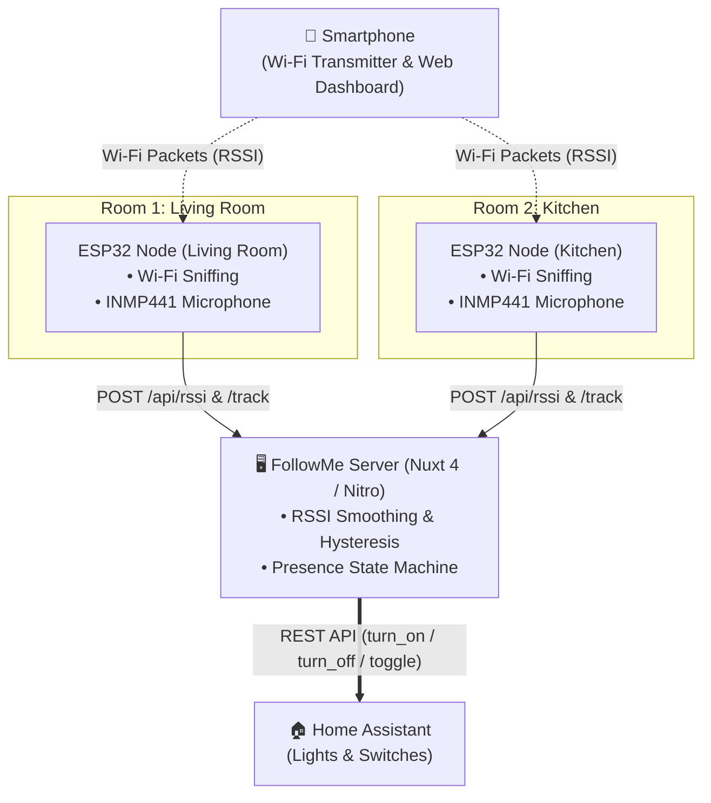
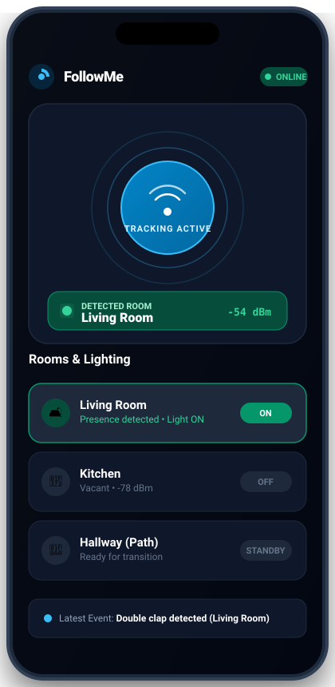
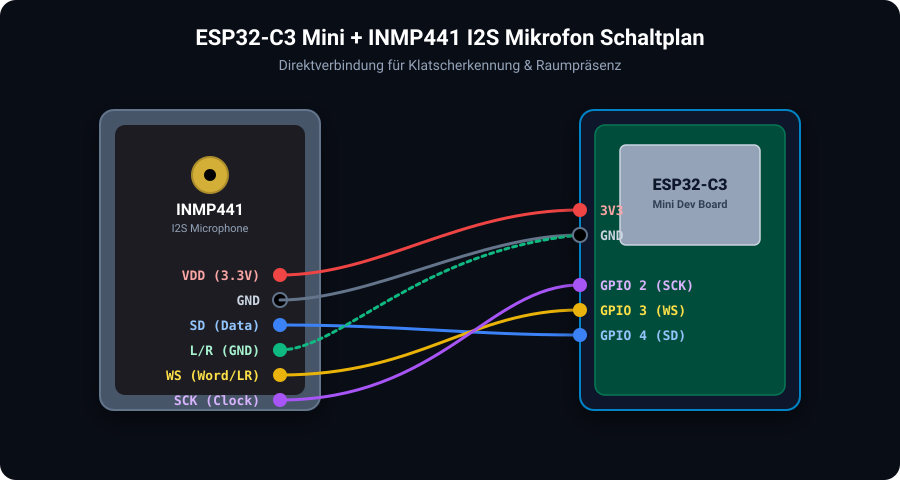

<div align="center">



# 📡 FollowMe — Room-Tracking Smart Home

**Local, room-accurate smartphone localization powered by ESP32 Wi-Fi promiscuous sniffing &amp; Bluetooth LE, intelligent lighting automation ("Light Follows Me"), adaptive hallway path lighting, and acoustic double-clap control integrated with Home Assistant.**

[](https://nuxt.com/)
[](https://vuejs.org/)
[](https://www.espressif.com/)
[](https://www.home-assistant.io/)
[](https://www.typescriptlang.org/)

</div>

---

## 🌟 Key Highlights

* 🎯 **Wearable-Free Localization:** Pinpoints your regular smartphone throughout your home using Wi-Fi RSSI sniffing and iBeacon broadcasts from distributed ESP32 nodes.
* 💡 **"Light Follows Me" Mode:** Automatically turns on lights upon entering a room and turns them off after a configurable delay (e.g., 5 seconds) after leaving.
* 👏 **Acoustic Double-Clap Recognition:** Built-in I2S microphone (INMP441) on each node detects claps to toggle lights in that specific room — no smartphone required.
* 🚶 **Adaptive Hallway Path Lighting:** Detects room transitions and automatically illuminates your hallway light for a preset duration (e.g., 40s) as a guiding path.
* 🎚️ **Structural Calibration & Dampening Offsets:** Neutralizes wall thickness and furniture interference with custom dB calibration offsets directly in the web UI.
* 📱 **Mobile-First Touch Dashboard:** Sleek Nuxt 4 SPA with Dark Mode, radar animations, Screen Wake Lock, and live activity feeds.

---

## 🏗️ System Architecture



---

## 📱 Mobile Dashboard

<div align="center">
  
</div>

* **Hero Radar Controller:** One-touch button to start/stop tracking with real-time location feedback.
* **Rooms & Switches:** Live overview of all configured rooms, signal strengths (dBm), and manual override switches.
* **Signal Calibration:** Per-room damping adjustment (+/- dB) with 1-click auto-calibration.
* **Activity Feed:** Live log of recent clap detections, presence transitions, and lighting triggers.

---

## 🔌 Hardware & Wiring

Each room is monitored by an **ESP32 Node** (such as an *ESP32-C3 Mini* or *ESP32 DevKit*) paired with an **INMP441 I2S digital microphone**.



### Pinout (ESP32-C3 Mini):

| INMP441 Pin | ESP32-C3 Pin | Description |
| :--- | :--- | :--- |
| **VDD** | **3.3V** | Power supply (do not connect to 5V!) |
| **GND** | **GND** | Ground |
| **L/R** | **GND** | Left audio channel selector (`I2S_STD_SLOT_LEFT`) |
| **SCK / BCLK** | **GPIO 2** | I2S Serial Clock |
| **WS / LRCL** | **GPIO 3** | I2S Word Select / Left-Right Clock |
| **SD / DOUT** | **GPIO 4** | I2S Serial Data |

> [!TIP]
> **For Standard ESP32 (WROOM-32):** Use pins such as `SCK = GPIO 14`, `WS = GPIO 15`, `SD = GPIO 32`. Avoid GPIO 6–11 on classic boards, as they are hardwired to internal SPI flash memory.

---

## 🚀 Quick Start Guide

### 1. Server Setup

1. **Clone the repository & install dependencies:**
   ```bash
   git clone https://github.com/timorywelski/FollowMe.git
   cd FollowMe
   npm install
   ```

2. **Configure environment variables:**
   Copy `.env.placeholder` to `.env`:
   ```bash
   cp .env.placeholder .env
   ```
   Add your Home Assistant instance URL and Long-Lived Access Token:
   ```env
   PORT=3000
   HA_URL=http://192.168.1.100:8123
   HA_TOKEN=your_long_lived_access_token_here
   ```

3. **Define Rooms ([rooms.json](rooms.json)):**
   Map your room IDs to your Home Assistant entity IDs:
   ```json
   {
     "wohnzimmer": "switch.shelly1mini_livingroom",
     "kueche": "light.kitchen_ceiling",
     "schlafzimmer": "light.bedroom_spots"
   }
   ```

4. **Start the server:**
   ```bash
   npm run dev
   # For production:
   npm run build && npm run start
   ```

---

### 2. Flash ESP32 Nodes

1. Open the sketch (`Room-Follower.ino` or `room_node.ino`) in the **Arduino IDE**.
2. Configure your Wi-Fi credentials and server endpoint at the top:
   ```cpp
   const char* WIFI_SSID     = "YourWiFiNetwork";
   const char* WIFI_PASSWORD = "YourPassword";
   const char* SERVER_BASE   = "http://192.168.30.166:3000"; // Server PC IP address
   const char* ROOM_ID       = "wohnzimmer";                 // Unique room identifier
   ```
3. Under **Tools $\rightarrow$ Partition Scheme**, select **Huge APP (3MB No OTA)**.
4. Upload the sketch to your ESP32!

---

### 3. Connect Smartphone

1. Open `http://<SERVER-IP>:3000` on your smartphone browser (connected to the same local network).
2. Under **Settings**, enter your smartphone's **Wi-Fi MAC Address**.
   > [!IMPORTANT]
   > Disable **"Private Wi-Fi Address"** in your phone's network settings for your home Wi-Fi, so its MAC address remains static.
3. Tap the radar button to start tracking $\rightarrow$ **Done!**

---

## 🌐 API & Webhook Endpoints

| Method | Endpoint | Description |
| :--- | :--- | :--- |
| `POST` | `/api/presence` | Smartphone presence heartbeat & signal updates |
| `POST` | `/api/rssi` | Signal strength (RSSI) reports submitted by ESP32 nodes |
| `POST` | `/track` or `/api/track` | Clap detection event trigger from ESP32 microphones |
| `GET` | `/api/node` | ESP32 configuration polling (active tracked MAC addresses) |
| `GET` | `/api/status` | Full system, user presence, and room state for dashboards |
| `ALL` | `/api/action/start` | Automation webhook (Apple Shortcuts / Android Routines) |
| `ALL` | `/api/action/stop` | Automation webhook to stop tracking session |

---

## 📄 License

MIT License — Feel free to use and adapt this project for your own smart home setup!
