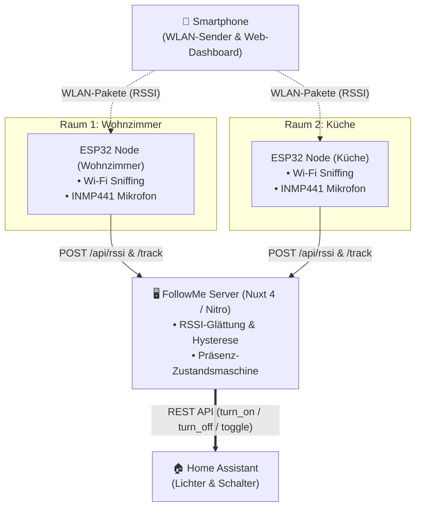

<div align="center">


# 📡 FollowMe — Room-Tracking Smart Home

**Lokale, präzise Smartphone-Ortung per ESP32-WLAN-Sniffing & Bluetooth LE, automatisches Raumlicht ("Light Follows Me"), adaptive Flur-Pfadbeleuchtung und akustische Doppel-Klatsch-Steuerung über Home Assistant.**

[](https://nuxt.com/)
[](https://vuejs.org/)
[](https://www.espressif.com/)
[](https://www.home-assistant.io/)
[](https://www.typescriptlang.org/)

</div>

---

## 🌟 Highlights

* 🎯 **Raumgenaue Ortung ohne Wearables:** Verfolgt dein normales Smartphone über RSSI-Sniffing (WLAN-Pakete) und iBeacon-Broadcasts verteilter ESP32-Nodes.
* 💡 **"Light Follows Me" Automatik:** Schaltet beim Betreten eines Raums vollautomatisch das passende Licht ein und nach einstellbarer Verzögerung (z. B. 5 Sekunden) beim Verlassen wieder aus.
* 👏 **Akustische Doppel-Klatsch-Erkennung:** Integriertes I2S-Mikrofon (INMP441) auf jedem Node toggelt das Licht im jeweiligen Raum bei zwei schnellen Klatschern – unabhängig vom Smartphone.
* 🚶 **Intelligente Flur-Pfadbeleuchtung:** Erkennt Raumwechsel und schaltet automatisch für einstellbare Sekunden (z. B. 40 s) das Flurlicht als Orientierungshilfe an.
* 🎚️ **Signaldämpfung & Raum-Kalibrierung:** Gleicht dicke Wände oder Möbel millimetergenau per Software-Offset (+/- dB) im Webinterface aus.
* 📱 **Mobile-First Touch-Dashboard:** Nuxt 4 SPA mit Dark-Mode, Screen Wake-Lock und Live-Radar.

---

## 🏗️ Systemarchitektur



---

## 📱 Mobile Dashboard

<div align="center">
  
</div>

* **Hero Radar Controller:** Großer Touch-Button zum Ein-/Ausschalten des Trackings inklusive Live-Status.
* **Räume & Schalter:** Sofortige Übersicht über alle konfigurierten Räume, Live-Signalstärken und manuelle Schalter.
* **Signal Calibration:** Dämpfungsausgleich pro Raum mit 1-Klick Auto-Kalibrierung.
* **Aktivitäts-Feed:** Live-Log aller Klatsch-, Präsenz- und Schaltvorgänge.

---

## 🔌 Hardware & Verkabelung

Jeder Raum erhält einen kompakten **ESP32 Node** (z. B. *ESP32-C3 Mini* oder *ESP32 DevKit*) mit einem **INMP441 I2S-Mikrofon**.


### Pinbelegung (ESP32-C3 Mini):

| INMP441 Pin | ESP32-C3 Pin | Funktion |
| :--- | :--- | :--- |
| **VDD** | **3.3V** | Stromversorgung (niemals an 5V!) |
| **GND** | **GND** | Masse |
| **L/R** | **GND** | Linker Audiokanal (`I2S_STD_SLOT_LEFT`) |
| **SCK / BCLK** | **GPIO 2** | I2S Clock |
| **WS / LRCL** | **GPIO 3** | I2S Word Select |
| **SD / DOUT** | **GPIO 4** | I2S Serial Data |

> [!TIP]
> **Für Standard ESP32 (WROOM-32):** Verwende z. B. `SCK = GPIO 14`, `WS = GPIO 15`, `SD = GPIO 32`. Vermeide auf klassischen Boards Pins zwischen 6 und 11 (interner Flash-Speicher).

---

## 🚀 Schnellanleitung (Quick Start)

### 1. Server einrichten

1. **Repository klonen & Abhängigkeiten installieren:**
   ```bash
   git clone https://github.com/timorywelski/FollowMe.git
   cd FollowMe
   npm install
   ```

2. **Umgebungsvariablen anlegen:**
   Kopiere `.env.placeholder` zu `.env`:
   ```bash
   cp .env.placeholder .env
   ```
   Trage deine Home Assistant URL und deinen langlebigen Token ein:
   ```env
   PORT=3000
   HA_URL=http://192.168.1.100:8123
   HA_TOKEN=dein_long_lived_access_token_hier
   ```

3. **Räume definieren ([rooms.json](rooms.json)):**
   Ordne deine Raum-IDs den Home Assistant Entities zu:
   ```json
   {
     "wohnzimmer": "switch.shelly1mini_wohnzimmer",
     "kueche": "light.kueche_decke",
     "schlafzimmer": "light.schlafzimmer_spots"
   }
   ```

4. **Server starten:**
   ```bash
   npm run dev
   # Für den Dauerbetrieb:
   npm run build && npm run start
   ```

---

### 2. ESP32 flashen

1. Öffne die Sketch-Datei (`Room-Follower.ino` oder `room_node.ino`) in der **Arduino IDE**.
2. Passe die Konfiguration ganz oben an:
   ```cpp
   const char* WIFI_SSID     = "DeinWLAN";
   const char* WIFI_PASSWORD = "DeinPasswort";
   const char* SERVER_BASE   = "http://192.168.1.136:3000"; // IP deines Server-PCs
   const char* ROOM_ID       = "wohnzimmer";                // Eindeutiger Raum
   ```
3. Wähle unter **Werkzeuge $\rightarrow$ Partition Scheme** die Option **Huge APP (3MB No OTA)**.
4. Sketch auf den ESP32 hochladen!

---

### 3. Smartphone verbinden

1. Öffne auf deinem Smartphone im WLAN: `http://<DEINE-SERVER-IP>:3000`
2. Trage unter **Einstellungen** deine **WLAN-MAC-Adresse** ein *(Wichtig: In den WLAN-Details des Handys „Private WLAN-Adresse“ deaktivieren)*.
3. Tippe auf den großen Radar-Button $\rightarrow$ **Fertig!**

---

## 🌐 API & Webhook Schnittstellen

| Methode | Route | Beschreibung |
| :--- | :--- | :--- |
| `POST` | `/api/presence` | Heartbeat & Signal-Meldungen vom Smartphone |
| `POST` | `/api/rssi` | Signalstärke-Reports (RSSI) der ESP32 Nodes |
| `POST` | `/track` oder `/api/track` | Klatsch-Events der ESP32 Mikrofone |
| `GET` | `/api/node` | Konfigurations-Polling für ESP32 Nodes (aktivierte MACs) |
| `GET` | `/api/status` | Vollständiger System- und Raumzustand für Dashboards |
| `ALL` | `/api/action/start` | Webhook für Apple Kurzbefehle / Android Routinen (Start) |
| `ALL` | `/api/action/stop` | Webhook für Automationen (Stopp) |

---

## 📄 Lizenz

MIT License — Frei verwendbar und anpassbar für dein eigenes Smart Home!
